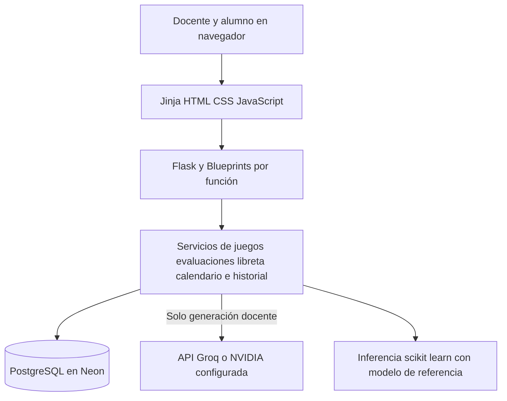

# Arquitectura del aula de computación con adaptación de TOGAF 9.2

Fecha de revisión: 15 de noviembre de 2026. Alcance: producto de tesis para cuarto, quinto y sexto de primaria, piloto de hasta seis conexiones simultáneas. Este expediente organiza la arquitectura y sus cambios usando el ADM. La implementación técnica es un monolito modular Flask con presentación, controladores, servicios y persistencia. TOGAF es el marco utilizado para relacionar decisiones de negocio, datos, aplicaciones y tecnología; no es una biblioteca instalada ni un certificado del sistema.

La adaptación se documenta durante la revisión del producto. No hay evidencia suficiente para afirmar que todo el desarrollo original siguió TOGAF desde su inicio. Tampoco se afirma adopción institucional completa: la conformidad técnica y la aprobación del colegio son hitos distintos.

## Visión y alcance del trabajo

El docente debe preparar material, revisar borradores de IA, publicar entrenamiento y evaluaciones, consolidar notas y decidir intervenciones. El alumno debe acceder desde cualquier equipo conectado, practicar sin alterar sus calificaciones y rendir evaluaciones con preguntas estables. La información debe sobrevivir a la suspensión del alojamiento gratuito.

Se incluyen autenticación, padrón, materiales, ocho juegos, prácticas, examen, libreta, calendario, historial y apoyo predictivo. Quedan fuera la matrícula administrativa completa, pagos, asistencia oficial y certificación de notas. No se promete servicio continuo en un plan que puede suspenderse.

| Interesado | Necesidad | Decisión y responsabilidad |
| --- | --- | --- |
| Estudiante | Actividades comprensibles y resultado persistente | Accede a sus propias actividades y resultados |
| Docente | Control del contenido y de las notas | Revisa y publica; vincula evaluaciones; autoriza recuperaciones |
| Responsable académico | Consistencia de las reglas | Debe confirmar calendario, último intento y uso oficial de la libreta |
| Tesistas | Evidencia verificable para sustentar | Mantienen expediente, pruebas y limitaciones de investigación |
| Responsable técnico | Operación recuperable con S/0 | Administra despliegue, secretos, migraciones y respaldo |

Los roles son responsabilidades propuestas para este piloto. No constituyen nombramientos aprobados por el colegio.

## Principios y requisitos

| ID | Principio o requisito | Consecuencia comprobable |
| --- | --- | --- |
| R01 | Persistencia compartida | Usuarios, resultados y archivos pequeños se conservan en PostgreSQL remoto |
| R02 | Juegos como entrenamiento | Los juegos no escriben notas académicas ni pesan en el promedio |
| R03 | Control docente de IA | Generar, editar, revisar y publicar son estados separados |
| R04 | Evaluación reproducible | El intento congela preguntas y claves al comenzar |
| R05 | Notas con procedencia | Tres componentes manuales y tres automáticos con fuente explícita |
| R06 | Cierre auditable | El cierre congela notas y pesos; la reapertura conserva motivo y actor |
| R07 | Incertidumbre visible | Sin evidencia no se inventan notas, probabilidades ni validación institucional |
| R08 | Respuesta del alumno independiente de IA | Jugar y calificar utilizan contenido guardado |
| R09 | Acceso por rol y grado | El alumno consulta su historial; no modifica la libreta ni contenido docente |
| R10 | Publicación sin datos personales | Secretos, padrón e historial individual quedan fuera del repositorio público |

## Arquitectura de negocio

Proceso: planificar clase → subir PPT o material → generar borrador → revisar y publicar → entrenar con juegos → resolver prácticas → rendir examen → consolidar libreta → decidir refuerzo → cerrar bimestre.

Los juegos son opcionales y sus puntos no son calificaciones. El docente selecciona expresamente qué evaluación alimenta práctica 1, práctica 2 y examen de cada grado, año y bimestre. Las prácticas admiten repetición; se toma el último resultado del periodo. El examen admite un intento de treinta minutos desde Comenzar; otro requiere reapertura docente. La vista previa no inicia el reloj. Las preguntas ya iniciadas no cambian si el docente edita el borrador.

Los pesos comunicados son tareas 10 %, participación 10 %, libro 10 %, práctica 1 10 %, práctica 2 10 % y examen 50 %. Faltar una nota deja el promedio pendiente; cero es una nota válida. El cierre requiere calendario confirmado y conserva una instantánea de notas, pesos y fechas. Las reglas de ausencia y aceptación oficial deben ser acordadas con el colegio, sin sustituir los pendientes por ceros.

## Arquitectura de datos

| Información | Persistencia y responsable de origen | Regla de calidad |
| --- | --- | --- |
| Usuarios y alumnos | users y students; padrón autorizado | Contraseña con hash; grado sin sección inventada |
| Material docente | topics, presentations y materiales | Trazabilidad al tema, grado y archivo |
| Juegos | ai_generated_games | Borrador revisado antes de publicar |
| Evaluaciones | assessment y questions | kind practice o exam; preguntas aprobadas |
| Intentos | learning_attempts y student_assessment_attempts | UUID, alumno, preguntas congeladas, respuestas y resultado |
| Notas | student_notes, bimester_manual_grades y bimester_component_sources | Fuente y periodo explícitos; escala numérica 0 a 20 |
| Calendario y cierre | school_year_bounds, academic_calendar, bimester_closures y eventos | Fechas confirmadas; instantánea y motivo de cambios |
| Historial literal | student_literal_history | AD/A/B/C originales, huella del archivo y fila; sin conversión numérica |

El registro disponible contiene quince alumnos de cuarto y únicamente el primer bimestre de 2026. Su resultado literal es la moda de cinco indicadores; en empate se elige el primero en orden de columnas, según la fórmula del archivo. Por tanto, usar esos mismos indicadores para predecir esa misma nota final no demostraría anticipación del rendimiento. El historial se conserva, pero la validación institucional temporal queda pendiente de resultados posteriores.

El modelo de referencia y el historial institucional se mantienen separados. Un error del modelo devuelve estado y probabilidad nula; un alumno sin historial no recibe una clasificación fabricada. Las cifras de una prueba pretest/postest de la tesis requieren sus instrumentos originales: ni las cuentas del padrón ni este registro de un bimestre verifican por sí solos esos resultados de investigación.

## Arquitectura de aplicaciones

El diagrama es una vista de solución en Mermaid, no una declaración de conformidad con la notación ArchiMate. `controllers/` gestiona HTTP y autorización; `services/` concentra reglas y acceso a datos; `views/` y `static/js/` presentan formularios. La separación permite localizar funcionalidades, aunque `db_service.py` y los controladores históricos siguen siendo grandes. Una siguiente mejora razonable es dividir repositorios por dominio conservando contratos y pruebas; seis usuarios no justifican añadir microservicios.

| Pregunta de sustentación | Archivo principal | Punto de uso |
| --- | --- | --- |
| Dónde se calcula la predicción | ml/pipeline/predictor.py | services/ml/prediction_service.py; endpoints docentes y del alumno |
| Dónde se entrenan modelos | ml/run_pipeline.py y ml/pipeline/trainer.py | Ejecución técnica separada de la petición web |
| Dónde se genera el juego desde PPT | services/material_extractor_service.py y ai_game_generator_service.py | controllers/teacher_ai_games_controller.py |
| Dónde se califica una evaluación | services/learning_attempt_service.py | controllers/student_assessment_controller.py |
| Dónde se pondera la nota | services/grading_policy_service.py | services/bimester_grade_service.py y reportes |
| Dónde se cierra el bimestre | services/academic_closure_service.py | controllers/settings_controller.py |
| Dónde se conserva el registro literal | services/literal_history_service.py | controllers/history_controller.py |

## Arquitectura tecnológica

La aplicación se ejecuta en un servicio web Render Free con Python, Flask y Gunicorn, un proceso y seis hilos configurados. Neon PostgreSQL es externo al disco efímero de Render. La conexión utiliza psycopg; los secretos se configuran en el servidor. Los archivos pequeños se guardan también en la base para soportar reinicios; para crecer conviene trasladarlos a almacenamiento de objetos y definir cuotas y respaldos.

Groq es el proveedor principal configurado; NVIDIA es una alternativa seleccionable, no un respaldo automático verificado en cada llamada. Ollama local no es requisito del despliegue. La generación tiene un límite de espera; el respaldo determinista se identifica y también necesita revisión. HTTPS, sesiones y comprobaciones de rol protegen el acceso. La caché del registro de modelos evita recargar el artefacto en cada inferencia. No se reducen los hashes de contraseña para acelerar el login.

## Estado anterior y arquitectura objetivo

La línea base de esta iteración es el commit bd09126a653e356189369ba3e4fae69c2ea7ba5d. Ya tenía nube, PostgreSQL y libreta de seis componentes. La descripción de una versión local anterior no se presenta como línea base de esta publicación.

| Brecha de la línea base | Solución implementada en esta iteración | Evidencia técnica |
| --- | --- | --- |
| Edición incompleta de cuatro juegos | Formularios visuales para los ocho tipos | teacher_game_editor.js; recorrido Edge |
| Notas manuales posibles en prácticas y examen | Vínculo obligatorio y cálculo desde intentos | test_bimester_gradebook.py |
| Calendario fijo y cierre ausente | Calendario editable, cierre congelado y reapertura | test_academic_calendar.py y test_academic_closure.py |
| Error ML tratado como porcentaje o falta de modelo | Estados explícitos sin probabilidad inventada | test_prediction_failures.py |
| Historial real literal fuera del sistema | Importación exacta, idempotente y con procedencia | test_literal_history.py y prueba PostgreSQL aislada |
| Un único examen visible por tema | Catálogo de prácticas y exámenes con inicio explícito | test_assessment_kinds.py y recorrido Edge |
| Evidencia técnica confundida con piloto humano | Informes separados y pendientes explícitos | validacion-cambios-nube.md y protocolo-piloto.md |

## Adaptación del ADM y hoja de ruta

| Etapa | Entregable de este proyecto | Estado y condición de salida |
| --- | --- | --- |
| Preliminar y A | Alcance, participantes, principios y visión anteriores | Expediente técnico preparado; aprobación institucional pendiente |
| B | Proceso y reglas de negocio | Acuerdos del usuario documentados; calendario y uso oficial por validar |
| C | Catálogo de información, módulos y flujos | Implementación y pruebas trazables |
| D | Vista de despliegue y restricciones gratuitas | Render y Neon existentes; disponibilidad limitada explícita |
| E y F | Brechas y paquetes de cambio | Migraciones aditivas → prueba aislada → publicación → verificación en nube |
| G | Control de conformidad y evidencia | Pruebas, revisión de archivos, SHA remoto y deploy; aceptación humana pendiente |
| H | Registro y tratamiento de cambios | Procedimiento siguiente; decisiones futuras deben dejar evidencia |
| Requisitos | IDs R01 a R10 y aceptación por caso | Revisión continua; pendientes no se marcan completados por documentarlos |

Paquetes de trabajo: P1 integridad de notas y ML; P2 editor y evaluaciones; P3 historial y configuración; P4 validación técnica y publicación; P5 aprobación escolar y piloto real; P6 recopilación longitudinal y eventual validación del modelo. P5 y P6 requieren evidencia externa y no quedan completados con pruebas automáticas.

## Decisiones y gobierno

ADR01 conserva el monolito modular para evitar complejidad operativa en el piloto. ADR02 usa PostgreSQL remoto para persistencia compartida. ADR03 genera contenido en el flujo docente y califica localmente en el servidor. ADR04 mantiene benchmark e historial literal separados. ADR05 exige vínculos automáticos y congela el cierre. ADR06 conserva secretos y registros personales fuera de GitHub.

Para cada cambio: registrar necesidad y requisito afectado; revisar impacto en negocio, datos, aplicación y tecnología; acordar cambios académicos con el docente; preparar migración y reversión; probar autorización y resultados; revisar publicación; desplegar y comprobar SHA, salud y flujo. La reversión de aplicación usa el commit previo; los cambios aditivos de base se conservan y no se borran registros escolares para retroceder código. Un cambio que altera notas exige análisis de su efecto en periodos cerrados antes de aprobarse.

El responsable técnico comprueba conformidad del código; el docente valida contenido; la autoridad académica acepta calendario y reglas. La evidencia de esas aceptaciones se registra con fecha y autor cuando exista. Este documento no inventa actas ni firmas.

## Referencias del marco

The Open Group, The TOGAF Standard Version 9.2, 2018, referencia de versión solicitada: https://www.opengroup.org/togaf-standard-version-92-overview (la página devolvió 403 en la consulta automatizada). Como explicación primaria accesible del método, dominios y gobierno se consultó [How the ArchiMate Language and the TOGAF Standard Complement Each Other](https://help.opengroup.org/hc/en-us/articles/32115987894930-How-the-ArchiMate-Language-and-the-TOGAF-Standard-Complement-Each-Other). La adaptación concreta, los límites y el mapeo al código son decisiones de este proyecto, no afirmaciones de certificación de The Open Group.
