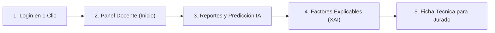

# Guía Rápida de Demostración para Tesista, Docente y Jurado

Esta guía está diseñada para que una tesista o docente **sin conocimientos técnicos profundos de programación** pueda realizar una demostración fluida, profesional y académicamente rigurosa del sistema ante un jurado evaluador o directivos del colegio en **5 minutos**.

---

## 1. Preparación y Puesta en Marcha (1 Clic)

No es necesario abrir consolas complejas ni memorizar comandos de terminal.

1. Ubique la carpeta del proyecto en su computadora.
2. Haga **doble clic** en el archivo:
   ```text
   iniciar_sistema.bat
   ```
3. El sistema verificará el entorno, levantará el servidor local y **abrirá automáticamente su navegador web** en la pantalla de inicio de sesión (`http://127.0.0.1:5000/login`).

> [!TIP]
> Si en algún momento desea apagar el sistema, simplemente cierre la ventana negra de la consola o presione `Ctrl + C`.

---

## 2. Guion de Demostración Paso a Paso (5 Minutos)



---

### Minuto 1: Inicio de Sesión y Acceso Demostrativo
* **Pantalla**: [Ingreso al Sistema](http://127.0.0.1:5000/login).
* **Qué hacer**:
  1. Mostrar al jurado la pantalla de bienvenida con el logotipo del colegio.
  2. En el recuadro inferior de *Acceso Rápido para Evaluación*, hacer clic en el botón azul:  
     **`[ Ingresar como Profesor (Demo) ]`**.
  3. El sistema autocompletará las credenciales (`profesor1` / `Admin123`) e iniciará sesión automáticamente.
* **Qué decir**:
  > *"El sistema cuenta con roles diferenciados para docentes y estudiantes. Para esta demostración ingresaremos con el rol docente para auditar las herramientas pedagógicas y el motor de predicción temprana."*

---

### Minuto 2: El Panel Principal del Docente
* **Pantalla**: Panel de Inicio del Docente.
* **Qué hacer**:
  1. Mostrar el saludo personalizado, las estadísticas de aula (total alumnos, progreso general) y la lista de estudiantes.
  2. En la sección de accesos directos, señalar la tarjeta destacada:  
     **`[ Predicción de riesgo IA ]`** y hacer clic en ella.
* **Qué decir**:
  > *"Desde su panel principal, el docente tiene una vista panorámica del rendimiento del aula y acceso inmediato al subsistema de alerta temprana mediante Inteligencia Artificial."*

---

### Minuto 3: Inferencia de Riesgo Académico en Tiempo Real
* **Pantalla**: Sección de Reportes y Predicción Académica.
* **Qué hacer**:
  1. Mostrar la tabla de calificaciones vigesimales ($0$ a $20$) por alumno.
  2. Notar que el sistema **selecciona automáticamente al primer alumno** y carga su análisis predictivo inmediatamente en la tarjeta de *"Predicción académica"*.
  3. Hacer clic en diferentes estudiantes de la tabla (por ejemplo, un estudiante con promedio alto y luego uno con promedio bajo).
  4. Observar cómo la tarjeta de predicción actualiza en tiempo real:
     * **Nivel de Riesgo**: Badge visual (*Bajo* en verde, *Medio* en ámbar, *Alto* en rojo).
     * **Probabilidad**: Porcentaje calibrado de riesgo (ejemplo: $98.8\%$ o $4.2\%$).
     * **Recomendación pedagógica personalizada**: Sugerencias de tutoría focalizada o mantenimiento de ritmo.
* **Qué decir**:
  > *"Al seleccionar cualquier estudiante, el modelo supervisado analiza su trayectoria formativa y proyecta su probabilidad de vulnerabilidad académica antes del cierre del periodo escolar, permitiendo una intervención docente oportuna antes de que repruebe."*

---

### Minuto 4: Inteligencia Artificial Explicable (XAI)
* **Pantalla**: Bloque de *Factores principales* dentro de la tarjeta de predicción.
* **Qué hacer**:
  1. Señalar la lista de factores con flechas rojas (`↓`).
  2. Leer en voz alta los factores generados para un alumno en riesgo alto:
     * *↓ Bajo rendimiento en evaluaciones formativas (promedio menor a 11)*
     * *↓ Tendencia descendente en las últimas calificaciones*
     * *↓ Última calificación registrada en nivel reprobatorio*
* **Qué decir**:
  > *"Una de las principales críticas a los sistemas de IA en educación es que funcionan como cajas negras misteriosas. Nuestro sistema incorpora IA Explicable (XAI): no solo entrega una alerta, sino que le explica al profesor exactamente qué variables formativas están detonando el riesgo para orientar la tutoría."*

---

### Minuto 5: Ficha Técnica y Preguntas del Jurado
* **Pantalla**: Botón y Modal de Ficha Técnica.
* **Qué hacer**:
  1. Dentro de la tarjeta de predicción, hacer clic en el botón:  
     **`[ Ver Ficha Técnica del Modelo (Métricas y Metodología para Jurado) ]`**.
  2. Se desplegará el modal interactivo con las métricas académicas oficiales.
  3. Mostrar los indicadores clave:
     * **Algoritmo**: *Random Forest Classifier* (Ensemble de 100 árboles de decisión).
     * **Sensibilidad (Recall)**: **90.48%** (Capacidad de detectar a 9 de cada 10 alumnos en riesgo).
     * **Exactitud (Accuracy)**: **91.15%**.
     * **ROC-AUC**: **0.9605**.
     * **Validación**: Temporal *Out-of-Time* (Entrenado con cohorte 2023, evaluado con cohorte 2024, 1,044 alumnos).
* **Qué decir**:
  > *"El modelo fue rigurosamente seleccionado tras comparar cuatro familias algorítmicas (Regresión Logística, Árboles de Decisión, Random Forest y Gradient Boosting), priorizando la Sensibilidad pedagógica para asegurar que ningún estudiante vulnerable quede sin apoyo."*

---

## 3. Respuestas Preparadas para Preguntas Comunes del Jurado

### Pregunta 1: *"¿Por qué usaron Random Forest y no Deep Learning o Redes Neuronales Profundas?"*
* **Respuesta**:
  > *"Por el principio de parsimonia y el tamaño muestral de la educación escolar. Las redes neuronales profundas requieren decenas de miles de registros para no sobreajustar y son cajas negras de difícil interpretación. Random Forest ofreció un ROC-AUC sobresaliente de 0.9605, computación ultra ligera (inferencia en milisegundos) y explicabilidad directa de las variables que el docente necesita conocer."*

### Pregunta 2: *"¿Por qué priorizaron Sensibilidad (Recall) en vez de Exactitud (Accuracy)?"*
* **Respuesta**:
  > *"Porque en educación la matriz de costos es asimétrica: un Falso Negativo (un alumno en riesgo al que no detectamos y termina reprobando o desertando) tiene un costo humano y académico gravísimo. En cambio, un Falso Positivo solo significa que le brindamos tutoría y refuerzo preventivo a un alumno que tal vez no lo necesitaba con tanta urgencia."*

### Pregunta 3: *"¿Cómo protegen la privacidad de los estudiantes según la ley peruana?"*
* **Respuesta**:
  > *"El sistema cumple estrictamente con la Ley N.º 29733 (Ley de Protección de Datos Personales de Perú). La matriz de características que procesa el modelo de Machine Learning está completamente anonimizada: no contiene nombres, apellidos, DNI ni identificadores de base de datos. Solo procesa métricas agregadas de desempeño, frecuencias y tendencias temporales."*

### Pregunta 4: *"¿Cómo garantizan que el modelo no hizo trampa mirando notas del futuro?"*
* **Respuesta**:
  > *"El pipeline implementa una política estricta de corte temporal (anti-leakage) con un parámetro `cutoff_date`. Al evaluar a un estudiante o entrenar el modelo, cualquier calificación, asistencia o actividad registrada después de esa fecha queda 100% filtrada e invisible para el extractor de características."*

### Pregunta 5: *"¿Este modelo ya está validado institucionalmente con este colegio?"*
* **Respuesta (Honestidad Académica)**:
  > *"No, y es fundamental remarcarlo: el modelo actual es un benchmark técnico probado sobre el reconocido dataset público de Cortez & Silva (2008), adaptado rigurosamente a la escala vigesimal peruana (CNEB, corte en 10.0). Nuestra arquitectura está diseñada para que, en cuanto el colegio consolide su propio historial institucional de notas, el sistema se reentrene con un solo comando sin necesidad de modificar una sola línea de código fuente."*

---

## 4. Resumen de Credenciales de Acceso

| Rol | Usuario | Contraseña | Propósito en la Demostración |
| :--- | :--- | :--- | :--- |
| **Profesor** | `profesor1` | `Admin123` | Evaluar panel de control, gestión de notas, predicción IA y ficha técnica. |
| **Alumno** | `alumno1` | `Alumno123` | Mostrar la vista del estudiante con sus temas, actividades y retroalimentación. |

---

## 5. Cierre de la Demostración

Para cerrar la demostración ante el jurado:
1. Concluir destacando el enfoque **Human-in-the-Loop** (el sistema no reemplaza al docente, lo empodera con información temprana y objetiva).
2. Cerrar la sesión haciendo clic en el icono de salida en la esquina superior derecha (`Cerrar sesión`).
3. Detener el servidor en la consola con `Ctrl + C`.
